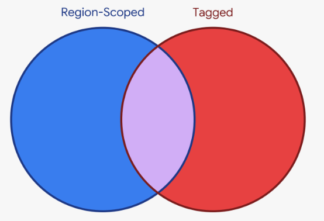

# Netbox RFC8805 Prefix Generator

Read-only utility to export Netbox IPAM prefixes to an [RFC8805](https://www.rfc-editor.org/rfc/rfc8805.txt)-compliant geofeed CSV file.

## Requirements

- Python 3.10 or later
- NetBox 4.2 or later
- A NetBox API token with permission to view IPAM prefixes and DCIM Regions
- Python packages listed in `requirements.txt`
- Use of the [ISO Online Browsing Platform](https://www.iso.org/obp/ui/) as the
  source for country and subdivision codes.

NetBox Regions must be defined in a three-level hierarchy with the following structure:

- **Country:** the top layer, represented by the two-letter ISO 3166-1
  alpha-2 code (for example, `CA` for Canada).
  - This becomes the RFC 8805 `alpha2code` field.
- **Province/state:** the second layer, represented by an ISO 3166-2
  subdivision code (for example, `CA-PE` for Prince Edward Island).
  - This becomes the RFC 8805 `region` field.
- **City:** the third layer, represented by a real city name.
  - This becomes the RFC 8805 `city` field.

The following is an example, using Canada as a reference country:

```text
Regions
└── CA
    ├── CA-ON
    │   ├── Ottawa
    │   └── Toronto
    └── CA-PE
        ├── Charlottetown
        └── Elmsdale
```

Within Netbox, set each relevant Prefix's **Scope** to its city Region. The exporter follows
that city's parent hierarchy to populate the corresponding geofeed fields.

Ex: Assume `192.0.2.0/29` is assigned to Charlottetown. Its Scope should be set to the `Charlottetown` Region. The script will derive the relevant province/state (CA-PE) and country codes (CA) from the Region hierarchy.

Note the following behaviours:

* If a Prefix has **no** Scope set, the Prefix is silently skipped.
* If the Scope Region cannot be resolved, or a parent Region is missing, the prefix is **skipped** and a
warning is printed.
    * See [Unresolved locations](#unresolved-locations).

## Setup

Create and activate a virtual environment, then install the required packages:

```sh
python3 -m venv .venv
source .venv/bin/activate
python -m pip install -r requirements.txt
```

Define the NetBox URL and API token in `.env`:

```dotenv
NETBOX_URL=https://netbox.example.com
NETBOX_TOKEN=your-token-value
NETBOX_TAG=
NETBOX_PREFIX_BLOCKLIST=10.0.0.0/8,100.64.0.0/10,172.16.0.0/12,192.168.0.0/16,2001:db8::/32
```

`NETBOX_TAG` is optional and defaults to empty. Leave empty to consider all Region-scoped
prefixes, or set it to one NetBox tag slug to include only Region-scoped prefixes with that
tag.

Consider the following:



If a tag is set, **only** the Prefixes which are both Region-Scoped **and** tagged (the purple intersection of the diagram) are kept.

🚨Use of this tag is very disruptive.🚨 Ensure all desired prefixes are correctly tagged, or they will no longer be included in the geofeed.

`NETBOX_PREFIX_BLOCKLIST` is optional and defaults to empty. Leave empty to disable exclusives, or enter comma-separated IP prefixes to
exclude.

If a blocklist overlaps only part of a
NetBox prefix, the exporter removes that address range and exports the
remaining CIDR pieces with the original location.

If any blocklist entry is not a valid IP prefix, the exporter stops before
contacting NetBox and names the offending entry, for example:
`Invalid entry '10.0.0.0/33' in NETBOX_PREFIX_BLOCKLIST: ...`.

The exporter fetches **only** prefixes whose Scope type is Region (`dcim.region`),
and, if `NETBOX_TAG` is set, only those with the configured tag. Prefixes whose
location cannot be fully resolved are then skipped, and the
blacklist is applied to the rest.

Transient NetBox server errors (HTTP 502, 503, and 504) are retried up to three
times with a short backoff, so a brief hiccup does not abort a multi-page
download.

## Run

Call ```python3 ./netbox_prefix_exporter.py```.

By default, this writes `geofeed.csv` in the current directory.
Use `--output` to choose a different path, ex:

```./netbox_prefix_exporter.py --output ./foo/bar/my_feed.csv```

The CSV begins with an RFC 3339 generated-time comment and a field-definition comment,
followed by the set of aggregated prefixes. Example output:

```text
# RFC8805 geofeed generated 2026-10-01T04:18:56+00:00
# ip_prefix,alpha2code,region,city,postal_code
192.0.2.0/24,CA,CA-ON,Toronto,
```

Adjacent IPv4 or IPv6 networks are aggregated only when their country, region,
and city fields are identical. Networks with different locations are not
merged.

### Unresolved locations

A prefix is skipped when its country, region, or city cannot be determined,
for example when its Scope Region has no parent Region. The exporter prints
one block to standard error: a warning per skipped prefix, a count, and a line
of advice:

```text
Warning: skipped 198.51.100.0/24 with scope id 12 (CA-PE): its Region, or a parent Region, could not be resolved.
Skipped 1 prefixes with unresolved locations.
Prefix Scope must be a city Region whose parent is a province/state and whose grandparent is a country -- see "Unresolved locations" in README.md
Exported 41 aggregated prefixes from 57 source prefixes to geofeed.csv
```

Each warning shows the prefix, the NetBox ID of its Scope Region, and that
Region's name in parentheses, so you can see at a glance which Region to fix
(here, a province-level Region used where a city is expected). The name is
omitted if the Region could not be found at all.

Common causes:

- The Scope is set to a province/state or country Region instead of a city.
- A level is missing from the hierarchy (for example, a city placed directly
  under the country).
- The API token's permissions do not allow viewing every Region, so the
  prefix points at a Region the exporter never received.

To fix a skipped prefix, correct the Region hierarchy or the Prefix's Scope in
NetBox and run the exporter again. The exit status is still 0 when prefixes are
skipped, so check the warnings if you run the exporter from a script or a
scheduled job.

## Tests

Install `pytest` and run the tests from the repository root:

```sh
python -m pip install pytest
python -m pytest
```

The tests mock all NetBox HTTP responses; they never contact a live NetBox.

## Notes & Suggestions

Before publishing the feed for ingestion by external parties, the generated CSV should be validated. An example validator is [geofeed-validator](https://github.com/massimocandela/geofeed-validator/releases/).
Download the release binary for your operating system and run it against the
output file. For example, on Linux:

```sh
./geofeed-validator-linux-x64 -f geofeed.csv
```

Validation can catch formatting and location-code errors, but it does not
confirm that locations are accurate. Before publishing, review the
`alpha2code`, `region`, and `city` columns in `geofeed.csv` for
locations that do not match the expected prefix location, and review any
warnings about skipped prefixes. Correct the Region hierarchy or Prefix Scope
in NetBox, run the exporter again, and review the updated CSV.
